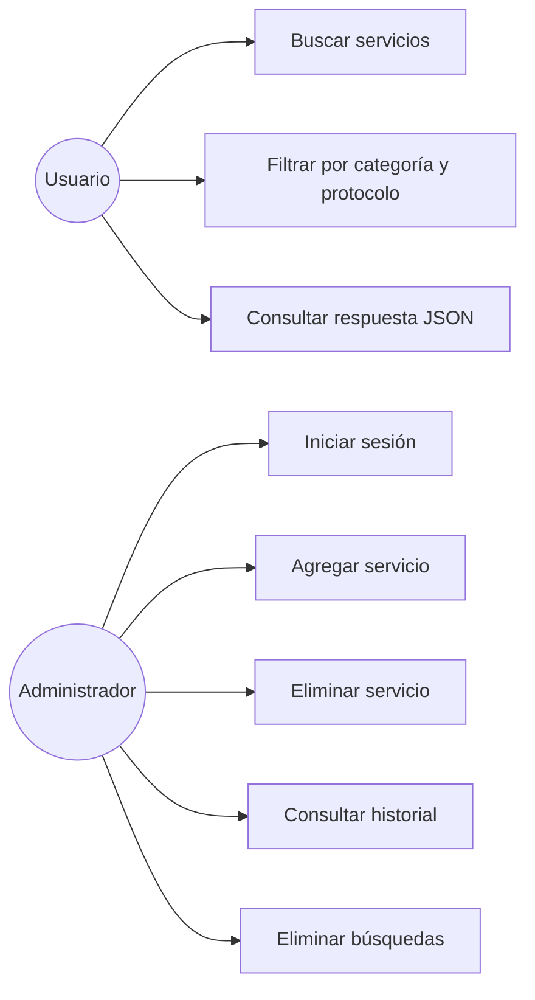
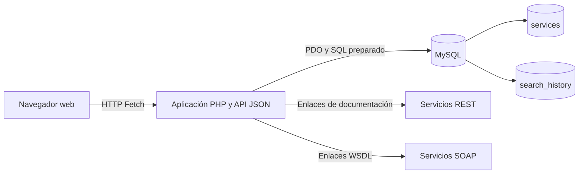
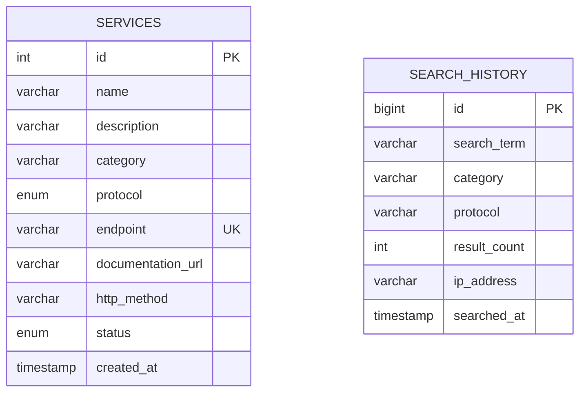

# Diagramas del sistema

Estos esquemas usan sintaxis Mermaid y pueden abrirse en GitHub, Mermaid Live Editor o extensiones compatibles de Visual Studio Code.

## Casos de uso

## Diagrama de componentes

## Modelo de datos

El historial no almacena una relación física con los servicios porque conserva el criterio ejecutado y la cantidad de coincidencias. Esta decisión evita duplicar resultados que pueden cambiar cuando se actualiza el catálogo.

